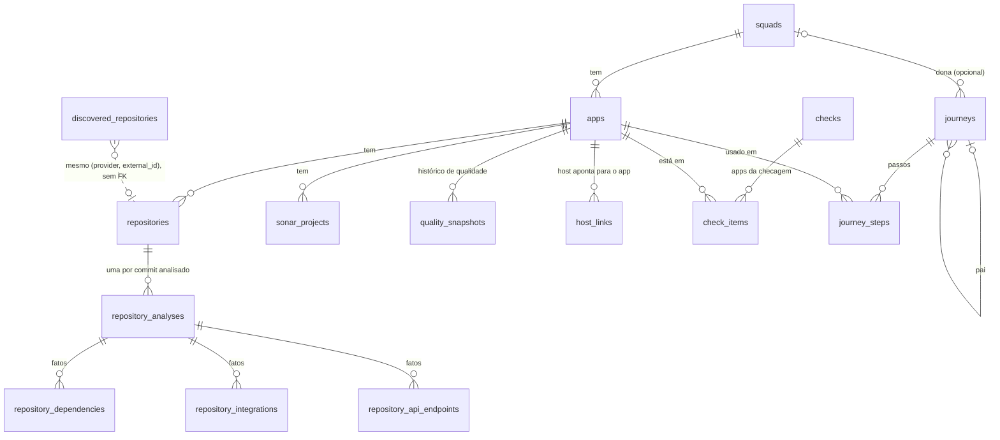
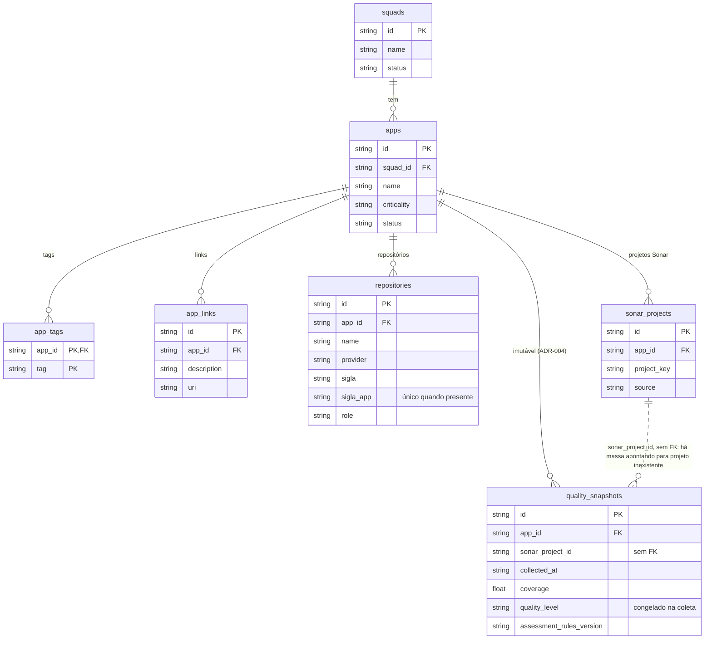
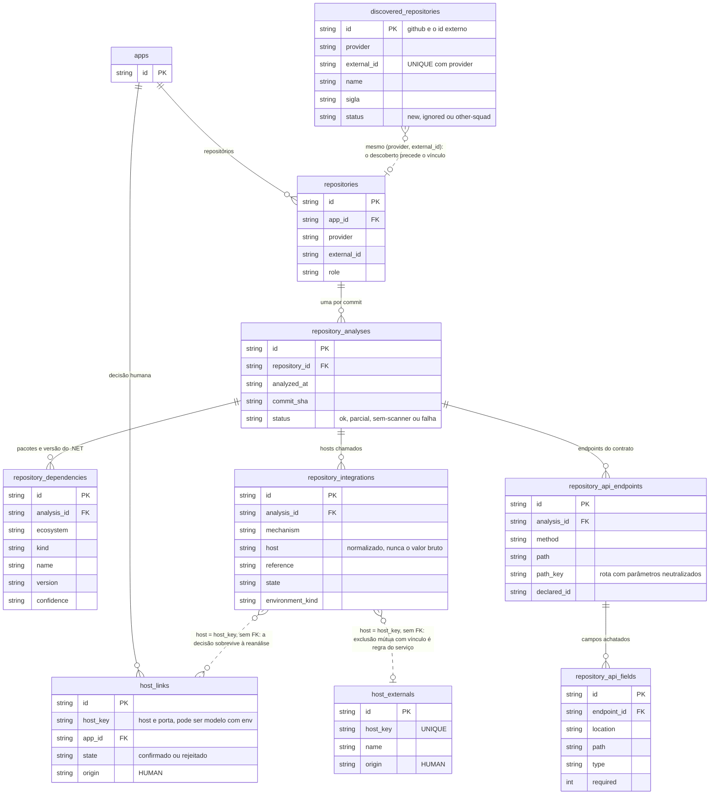
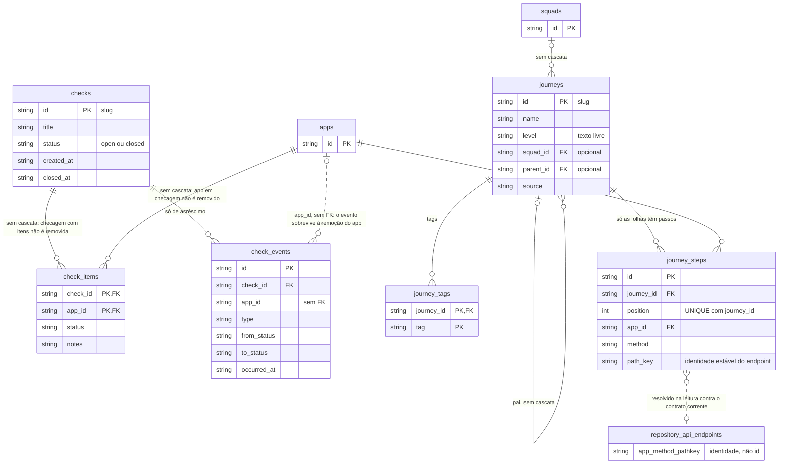

# Diagrama do modelo de dados

> **Fonte da verdade**: `src/CheckApps.Infrastructure/Sqlite/schema.sql`. Os diagramas abaixo mostram as relações e as colunas-chave; as colunas completas e as decisões estão em `schema.sql` e em `sqlite-schema.md`. Se divergirem, o `schema.sql` está certo. **Mudou uma tabela, uma chave ou uma relação? Atualize o diagrama da área na mesma mudança.**
>
> Diagramas em Mermaid: o GitHub e o VS Code (com a extensão *Markdown Preview Mermaid Support*) renderizam direto.

**Como ler**

- Linha **cheia** (`--`): chave estrangeira (FK) no banco.
- Linha **pontilhada** (`..`): ligação **lógica**, sem FK, de propósito. O rótulo diz por quê. Em geral é um fato ou uma decisão que precisa sobreviver a quem ele aponta.
- `||` exatamente um, `o|` zero ou um, `o{` zero ou muitos, `|{` um ou muitos.
- Os valores de data são TEXT ISO-8601 UTC; os ids são gerados na aplicação.

## 1. Visão geral

Só as tabelas-chave e as ligações entre as áreas. Cada área tem o seu detalhe nas seções seguintes.

## 2. Catálogo e qualidade (specs 001, 002)

O App não guarda estado de qualidade: o nível atual é o snapshot mais recente, derivado por consulta (ADR-009).

## 3. Repositórios, análises, integrações e contratos (specs 005, 013, 014, 017, 019, 021)

Uma análise é uma foto de um repositório num commit. A análise **corrente** é a mais recente que não falhou, derivada por consulta. O que mudou entre dois commits é calculado na leitura, nunca gravado.

## 4. Checagens e jornadas (specs 003, 022)

Os passos de uma jornada apontam para a **identidade estável** de um endpoint (app + método + `path_key`), nunca para a linha de uma análise. A resolução contra o contrato e o impacto das mudanças são calculados na leitura.

## Regras de remoção, em uma olhada

| Ao remover… | O que acontece |
|---|---|
| **squad** | Recusado (409) se tiver apps ou jornadas |
| **app** | Recusado (409) se tiver snapshot de qualidade, estiver numa checagem ou num passo de jornada. Sem isso, leva tags, links, repositórios, projetos Sonar, vínculos de host e análises |
| **checagem** | Só vazia; leva o histórico dela |
| **jornada** | Leva tags e passos; recusado (409) se tiver filhas |
| **repositório** | Leva as análises e tudo que elas contêm |
